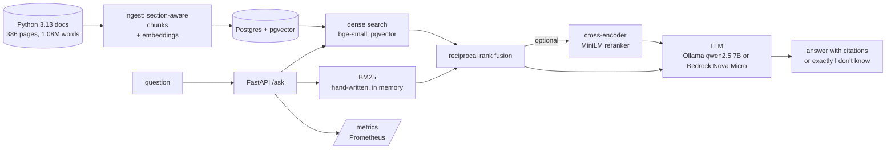
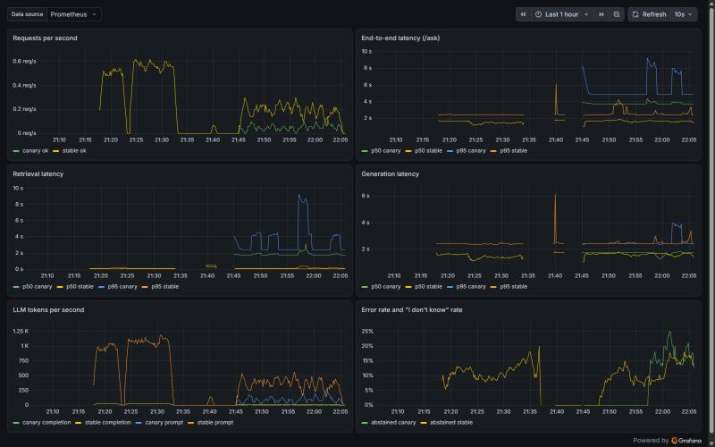

# rag-evals-service

A question-answering service over the Python 3.13 documentation. The point of the repo is the evaluation, not the
chatbot. It has four parts:

* a golden set whose gold passages are located inside the docs;
* retrieval ablations with bootstrap confidence intervals;
* an LLM judge checked against hand labels;
* latency measured per stage.

**Results in one paragraph** (all 140 golden questions):

* Hybrid retrieval (BM25 + dense vectors, reciprocal rank fusion) finds the gold passage in the top 5 for 81% of
  questions, against 69% for BM25 alone. The gain is significant on a paired bootstrap.
* A cross-encoder reranker *lowers* that retrieval metric to 76%, yet *raises* judged answer accuracy by 6–9
  points. A single gold passage is too narrow a definition of "relevant".
* Answer accuracy for qwen2.5 7B is between 0.71 and 0.84, depending on which judge prompt you believe. The judge is
  the weakest part of the evaluation; the [judge section](#how-far-the-llm-judge-can-be-trusted) explains why.
* On my own 30 hand-written questions the strict judge scores the system much lower than on the LLM-drafted ones
  (0.53 vs 0.76).



## Data

* **Corpus:** the plain-text Python 3.13 docs (PSF licence, archive in `data/raw/`). It covers the tutorial,
  library, built-ins, reference, howto, FAQ and glossary; "what's new" is excluded. 386 pages, 1,078,564 words.
* **Chunking:** word windows with 20% overlap that never cross a section heading. Each chunk is prefixed with
  "page title > section" and keeps its character span in the source page.
* **Golden set** (`eval/golden/golden.csv`):
  * 110 answerable questions, each with a reference answer and the exact gold passage. Every passage is located
    inside the docs automatically, and the build fails if one is not found.
  * 8 unanswerable questions (the answer is not in the docs), where the only correct answer is "I don't know".
  * 30 more answerable questions I wrote myself (`author=mykyta`), mostly "why" and two-part questions about
    real Python gotchas. Their passages were found and located the same way.
  * The first 110 were drafted with an LLM and are being reviewed by hand (`status` column).
* **Relevance:** a retrieved chunk counts as relevant if it covers at least 50% of the gold passage's characters.

## Results

All numbers below are for the 110 answerable questions. Brackets are 95% percentile-bootstrap intervals (10,000
resamples, seed 0). Each run is saved with its git commit in `eval/results/`. "Significant" means the 95% interval
of the *paired* difference (resampling the same questions for both setups) excludes zero.

### Retrieval (`python -m eval.retrieval_eval`)

| Chunk size (words) | Method | hit@5 | MRR@10 | hit@budget¹ | p50 latency |
|---|---|---|---|---|---|
| 128 | BM25 | 0.591 [0.500, 0.682] | 0.410 | 0.736 | <1 ms |
| 128 | dense | 0.736 [0.655, 0.818] | 0.529 | 0.791 | 9 ms |
| 128 | hybrid | 0.827 [0.755, 0.891] | 0.576 | **0.864** [0.800, 0.927] | 10 ms |
| 128 | hybrid + rerank | 0.727 [0.645, 0.809] | 0.484 | 0.827 | 1.9 s |
| 256 | BM25 | 0.700 [0.609, 0.782] | 0.524 | 0.645 | <1 ms |
| 256 | dense | 0.727 [0.645, 0.809] | 0.574 | 0.691 | 8 ms |
| **256** | **hybrid** | **0.836** [0.764, 0.900] | **0.648** [0.575, 0.718] | 0.818 | 9 ms |
| 256 | hybrid + rerank | 0.755 [0.673, 0.836] | 0.550 | 0.709 | 2.2 s |
| 512 | BM25 | 0.718 [0.627, 0.800] | 0.562 | 0.591 | <1 ms |
| 512 | dense | 0.691 [0.609, 0.773] | 0.575 | 0.582 | 8 ms |
| 512 | hybrid | 0.773 [0.691, 0.845] | 0.631 | 0.664 | 9 ms |
| 512 | hybrid + rerank | 0.764 [0.682, 0.836] | 0.560 | 0.582 | 2.1 s |

¹ hit@budget gives every chunk size the same ~1,024 words of context: k = 8, 4 and 2 for sizes 128, 256 and 512.
Comparing hit@5 across chunk sizes is unfair, because five 512-word chunks are four times more text than five
128-word chunks.

* **Hybrid beats BM25 at 128 and 256 words.** At 256 words the paired difference is +0.136 [0.064, 0.218] in
  hit@5. At 512 words only MRR is significantly better (+0.070 [0.018, 0.121]). Dense alone is *not* significantly
  better than BM25 at 256 or 512 words. The two retrievers miss different
  questions, so fusing them is what helps.
* **Smaller chunks win at equal context.**
  * 128 vs 256 words: hit@budget is higher at 128, significantly so for BM25, dense and rerank. For hybrid the
    difference is +0.045 [−0.009, 0.109].
  * 512 vs 256 words: significantly worse for dense, hybrid and rerank.
  * The service still uses 256 words so that each answer cites 5 coherent passages rather than 8 fragments. That
    is a product choice, and this table shows its cost.
* **The reranker hurts the retrieval metrics.** It loses 8 points of hit@5 at 256 words and costs ~2 s of CPU per
  query. The next table shows why that is not the whole story.

### Answers (`python -m eval.answer_eval`, `python -m eval.judge`)

Setup: chunk size 256, top 5 passages, qwen2.5:7b-instruct at temperature 0 through Ollama on an RTX 3060 Ti.

| Setup | Judged accuracy, judge v1² | judge v3 | False "I don't know" | Correct "I don't know" (8 unanswerable) | p50 / p95 latency |
|---|---|---|---|---|---|
| No LLM: return the top passage (floor) | 0.345 [0.255, 0.436] | n/a | 0% | 0 / 8 | 9 ms / 11 ms |
| qwen2.5 7B + hybrid | 0.855 [0.782, 0.918] | 0.745 [0.664, 0.827] | 3.6% | 8 / 8 | 1.4 s / 2.0 s |
| qwen2.5 7B + hybrid + rerank | 0.918 [0.864, 0.964] | 0.818 [0.745, 0.891] | 4.5% | 8 / 8 | 3.6 s / 4.3 s |

² The judge v1 run for "hybrid" predates the fix of one reference answer (q039, below). Everything else was judged
after the fix.

* **The reranker helps the answers, even though it hurts hit@5.** The paired difference in judged accuracy depends
  on the judge:
  * judge v1: +0.064 [0.009, 0.127], 9 wins and 2 losses;
  * judge v3: +0.073 [0.000, 0.155], 14 wins and 6 losses, borderline.

  The likely reason is that many answers appear in more than one place (FAQ, glossary, module page). The reranker
  finds one of those, the generator is happy with any of them, and the metric only credits the single gold passage.
  **Offline retrieval metrics built on one gold passage per question undercount. The end-to-end number is the one
  to optimise.**
* **Where the time goes.** With hybrid, almost all of the 1.4 s is generation. With hybrid + rerank, the reranker
  on CPU adds 2.2 s of the 3.6 s. In production the reranker would run on the GPU; here the GPU is busy with the LLM.

### All 140 questions, and hand-written vs LLM-drafted

The tables above cover the 110 LLM-drafted questions. Adding my 30 hand-written ones (run 2026-11-21, same
settings):

| Setup | All 140 | 110 drafted | 30 hand-written |
|---|---|---|---|
| hit@5, BM25 (size 256) | 0.686 [0.607, 0.757] | 0.700 | 0.633 [0.467, 0.800] |
| hit@5, hybrid | 0.814 [0.750, 0.879] | 0.836 | 0.733 [0.567, 0.867] |
| hit@5, hybrid + rerank | 0.757 [0.686, 0.829] | 0.755 | 0.767 [0.600, 0.900] |
| Accuracy, qwen + hybrid, judge v1 | 0.843 [0.779, 0.900] | 0.845 | 0.833 [0.700, 0.967] |
| Accuracy, qwen + hybrid, judge v3 | 0.714 [0.636, 0.786] | 0.764 | **0.533** [0.367, 0.700] |
| Accuracy, qwen + rerank, judge v1 | 0.929 [0.886, 0.971] | 0.927 | 0.933 [0.833, 1.000] |
| Accuracy, qwen + rerank, judge v3 | 0.779 [0.707, 0.843] | 0.800 | 0.700 [0.533, 0.867] |

* **The conclusions hold on 140 questions.**
  * Hybrid vs BM25 hit@5: +0.129 [0.071, 0.193].
  * 128 vs 256 words at equal context: still better for BM25, dense and rerank. 512 words: still worse for dense,
    hybrid and rerank.
  * Rerank vs hybrid accuracy: +0.086 [0.036, 0.143] with judge v1, +0.064 [−0.007, 0.136] with judge v3.
  * Unanswerable questions: 8 of 8 refused correctly. False refusals on answerable questions: 6.4%.
* **Hand-written questions are harder,** but only the strict judge sees it.
  * Under v3, accuracy on my 30 questions is 0.53, against 0.76 on the drafted ones. Under v1 the two groups are
    the same (0.83 vs 0.85).
  * My questions are mostly "why … and how should I …". v3 checks that every part is answered and that a "why" is
    answered with the right reason; v1 does not.
  * So either v3 catches real half-answers that v1 misses, or it is harsher on long questions. Telling the two
    apart needs hand labels on these 30 answers.
  * The retrieval gap points the same way: BM25 drops from 0.70 to 0.63 and dense does not (0.73 → 0.77).
    LLM-drafted questions share more words with their source passage. That fits the general warning that an
    LLM-written test set flatters lexical retrieval.
  * With n = 30 none of these gaps is significant on its own; the intervals overlap.
* The latency of the rerank run on 140 questions (p50 6.3 s) is not reported. A CPU retrieval benchmark ran at the
  same time and slowed the CPU reranker. The clean numbers are in the table above.

## How far the LLM judge can be trusted

The judge (llama3.1:8b, a different model family from the qwen2.5 generator) marks each answer correct or incorrect
against the reference answer. I compared it with my own hand labels. `python -m eval.judge_compare <answers file>`
recomputes this table from the saved verdicts.

| Prompt | Labels | Agreement | Cohen's κ | Wrong answers caught | Right answers rejected | Judged accuracy of the run |
|---|---|---|---|---|---|---|
| v1: "key fact, nothing contradicting" | 40, qwen + hybrid | 0.825 | 0.26 | 2 / 6 | 3 / 34 | 0.855 |
| v2: five rules as one list | same 40 | 0.650 | 0.30 | 6 / 6 | 14 / 34 | 0.455 |
| v3: four yes/no checks, verdict combined in code | same 40 | 0.825 | 0.49 | 5 / 6 | 6 / 34 | 0.745 |
| v1 | 20 fresh, qwen + hybrid + rerank | 0.950 | 0.00 | 0 / 1 | 0 / 19 | 0.918 |
| v2 | same 20 | 0.600 | 0.12 | 1 / 1 | 8 / 19 | 0.464 |
| v3 | same 20 | 0.950 | 0.00 | 0 / 1 | 0 / 19 | 0.818 |

What this does and does not show:

- **v1 is too lenient.** On the first 40 labels it passed 4 of the 6 answers I marked wrong. Examples: an answer
  that explains `str.lstrip` as removing a prefix, and an answer to only half of a two-part question. Its 0.855
  accuracy is inflated.
- **The 40-label numbers for v2 and v3 are optimistic.** I wrote both prompts after reading v1's 7 disagreements on
  those same 40 answers. The rules are general rather than per-question patches, but they were still shaped by
  those cases.
- **A rule list (v2) made the 8B judge nitpick.** It rejected correct answers for "extra details", even though one
  of its rules says extra true details are fine. Splitting the decision into narrow yes/no questions and combining
  them in code (v3) fixed most of that.
- **The clean check is too small to rank v1 against v3.** The 20 fresh labels cover questions I never looked at
  while writing the rules, with answers from a different run.
  * Only 1 of the 20 answers was wrong (it reversed the meaning of `usedforsecurity=False`), and v1 and v3 both
    passed it.
  * κ is 0 there because neither judge said "incorrect" even once. The 0.95 agreement only reflects how few wrong
    answers there were.
  * What the fresh set does show: v2 is unusable (8 of 19 right answers rejected), and v3's false rejections on
    the tuning set (6 of 34) did not show up here (0 of 19).
- **Conclusion: report answer accuracy as a range, not one number.** For qwen + hybrid that range is v3's 0.745
  to v1's 0.855. Two next steps would narrow it:
  * label more wrong answers, so the check can tell v1 and v3 apart;
  * try a stronger judge. The 8B model is the bottleneck: no prompt made it both strict and fair.

## What went wrong (and what I changed)

* **Built-in functions were missing from the corpus.** This docs build keeps `builtins/` outside `library/`, and
  my section filter dropped it, so questions about `sorted()` or `int` had no gold passage to find. It showed up
  because those golden-set passages failed to locate. Fixed by indexing the folder and re-embedding everything.
* **Section headings leaked into chunk bodies.** The heading underline (`=====`) was also counted as words. Fixed
  in the section splitter, with a test.
* **Reading the `.tar.bz2` in sorted order took 48 s instead of 2 s.** Each out-of-order member makes bz2
  decompress from the start again. Fixed by reading in stream order and sorting afterwards.
* **"I don't know." followed by a reason was not counted as abstaining.** An answer like "I don't know. The
  excerpts only cover pip." is a refusal, but the exact-match rule missed it, which understated the correct-abstention
  rate. Fixed to a prefix match, and the runs were regenerated.
* **Hand labels were keyed by question id only.** The judge on run B would have been scored against my labels of
  run A's answers. Labels now record which answers file they belong to.
* **A golden-set reference answer was wrong.** The `bisect.insort` reference described `insort_left`, so a wrong
  answer looked right. Found while hand-labelling and fixed. LLM-drafted references need the same review as LLM
  answers.
* **Batch sizes that worked on my desktop OOM-killed containers.** Embedding 64 chunks of up to 512 tokens at
  once killed the ingest container in a 2 GB Fargate task, and reranking 30 passages in one batch got the canary pod
  OOM-killed at its 1.5 GiB limit. Attention memory grows with batch × length². Batches of 16 (embedding) and 8
  (reranking) fit and are barely slower.
* **The first canary got no traffic.** kube-proxy balances *connections*, not requests, and the load generator
  reused one keep-alive connection, so every request landed on the same stable pod. It now opens a connection per
  request.
* **The API crash-looped on Kubernetes** while Postgres started and the docs were being embedded. It now has an
  init container that waits until the chunks table is filled.
* **kind would not start on this machine.** Docker Desktop's WSL kernel still uses cgroup v1, and recent kubelets
  refuse it, so the node image is pinned to Kubernetes 1.34.
* **The cross-encoder made retrieval worse on these docs.** It was trained on web search queries (MS MARCO). I keep
  it as an option because it still improves the answers, for the reason given above.

## How to run

Requirements:

* Python 3.12 via [uv](https://docs.astral.sh/uv/);
* [Ollama](https://ollama.com) with `qwen2.5:7b-instruct` and `llama3.1:8b`;
* Docker, for the Postgres parts.

```bash
uv sync
uv run pytest -q                                    # unit tests, no network or GPU needed
uv run python -m ragsvc.ingest --sizes 128 256 512  # chunk + embed the docs into data/index/ (CPU, slow once)
uv run python -m eval.retrieval_eval                # the retrieval table
uv run python -m eval.answer_eval --backend ollama --method hybrid
uv run python -m eval.judge eval/results/answers_<stamp>.json --prompt v3
uv run python -m eval.label eval/results/answers_<stamp>.json --n 40   # hand labels for the judge check
uv run python -m eval.judge_compare eval/results/answers_<stamp>.json
```

To run the service with Postgres + pgvector (Ollama stays on the host):

```bash
docker compose up --build
curl -s localhost:8000/ask -H 'content-type: application/json' -d '{"question": "How do I reverse a list?"}'
```

Configuration is through environment variables (`ragsvc/config.py`):

| Variable | Default | Meaning |
|---|---|---|
| `RAG_RETRIEVER` | `hybrid` | `bm25`, `dense`, `hybrid` or `hybrid_rerank` |
| `RAG_CHUNK_SIZE` | `256` | chunk size in words |
| `RAG_LLM_BACKEND` | `ollama` | `ollama`, `bedrock` or `extractive` |
| `RAG_STORE` | `postgres` | `postgres`, or `memory` for tests |

## Kubernetes: a canary of the reranker, on kind

`deploy/` holds a Helm chart for [kind](https://kind.sigs.k8s.io) with these parts:

* Postgres + pgvector, plus the ingest Job.
* A **stable** Deployment (`hybrid`, 3 replicas) and a **canary** Deployment (`hybrid_rerank`, 1 replica) behind
  one Service. Traffic splits by replica count, so the canary gets about 25%.
* A PodMonitor for Prometheus and a Grafana dashboard (kube-prometheus-stack).

`ops/canary_check.py` reads Prometheus and returns PROMOTE, ROLLBACK or WAIT. The canary is promoted only if all
of these hold:

* its error rate is at most stable's + 1 point;
* its p95 latency is at most 1.25 × stable's + 0.5 s;
* its "I don't know" rate is at most stable's + 10 points;
* it has served at least 30 requests.

```bash
kind create cluster --config deploy/kind/cluster.yaml
kind load docker-image rag-evals-service:latest --name rag
helm install monitoring prometheus-community/kube-prometheus-stack -n monitoring --create-namespace \
  -f deploy/monitoring/kube-prometheus-stack.yaml
helm install rag deploy/helm/rag -n rag --create-namespace --set canary.enabled=true
uv run python -m ops.load --url http://localhost:30080 --rounds 2 --workers 1 --pause 2
uv run python -m ops.canary_check        # Grafana: http://localhost:30300 (admin/admin, local only)
```

**Result (2026-11-21).** After 296 requests, 62 of them (21%) to the canary, `canary_check` said:

```
canary  requests    50  errors   0.0%  p95   4.98s  abstained  12.2%
stable  requests   171  errors   0.0%  p95   2.47s  abstained  11.3%
ROLLBACK: p95 4.98s vs stable 2.47s
```

That is the right call by the rule, and it matches the offline evaluation. The reranker answers better (+6–9
points), but on CPU it adds about 2.5 s at p95, which breaks the latency budget. To ship it, the reranker would
need a GPU or fewer candidates (`rerank_top`), and then a second canary.



How to read the dashboard:

* **21:17–21:33:** all traffic on stable. From 21:23 the canary was up, but the load generator's single
  keep-alive connection pinned every request to one pod.
* **~21:40:** the first canary attempt. Its pod was OOM-killed on the first reranked request (see "what went
  wrong").
* **From 21:45:** stable + canary. The canary's p95 sits around 5 s against stable's 2.5 s, and the extra time is
  all in retrieval (the reranker), not in generation.

**AWS** (`infra/aws/`): Terraform for one ECS Fargate task with Bedrock, without a load balancer, NAT or EKS. Cost
and teardown are in [infra/aws/README.md](infra/aws/README.md). *Not yet applied.*

## Licence

Code: MIT. The Python documentation in `data/raw/` is © Python Software Foundation, under the PSF licence
(see `data/raw/NOTICE.md`).
